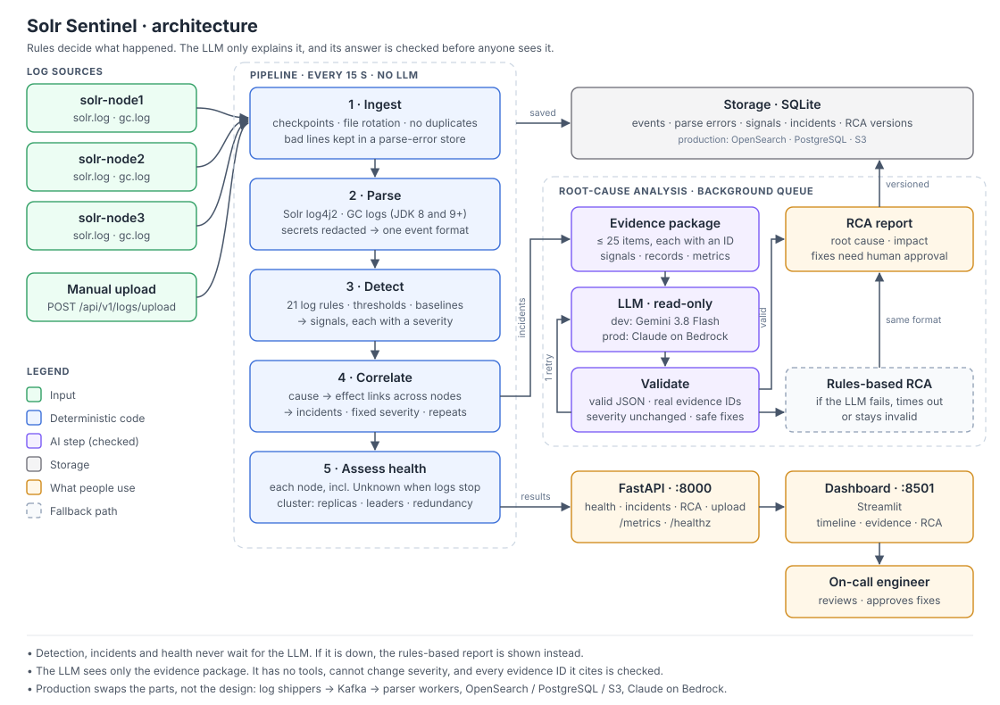
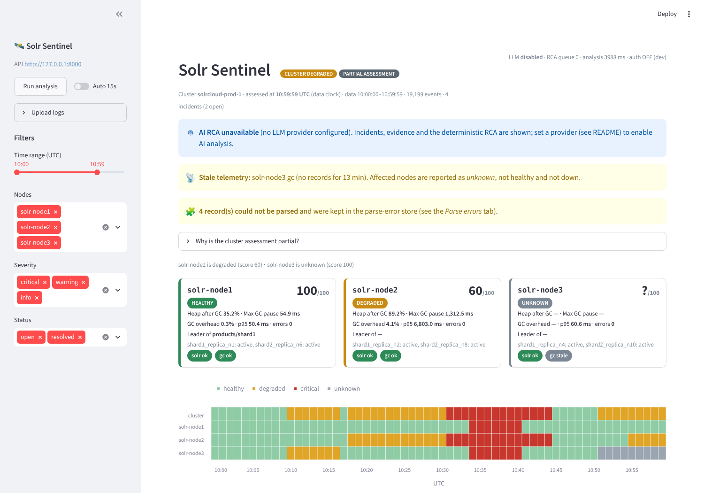

# Solr Sentinel

Solr Sentinel reads SolrCloud and JVM GC logs, spots problems, groups related events into incidents, and
explains each incident: what caused it, what it affects, and what to do about it.

It is the working prototype for the case study *AI-Powered Solr Observability & Root Cause Analysis*. The full
design is in [docs/Solr_Sentinel_Complete_System_Design.docx](docs/Solr_Sentinel_Complete_System_Design.docx).

**One rule shapes the whole design: code decides what happened, and the LLM explains it.** Detection,
incidents, severity and health are all deterministic. The LLM gets a small, labelled evidence package, and its
answer is checked before anyone sees it. If the LLM is down, everything else keeps working and a rules-based
report is shown instead.



## Results

| Check (5 random seeds, see [docs/EVALUATION.md](docs/EVALUATION.md)) | Result |
|---|---|
| Problems found / false alarms | 100 % found, 0 false alarms |
| Incident checks (root cause, nodes, severity, recurrence, Unknown state) | 19/19 on every seed |
| Control run with nothing planted | 0 signals, 0 incidents on every seed |
| Each problem on its own | 90/90 checks, no cross-talk |
| Every threshold moved ±25 %, one at a time | 22 of 24 variations pass everything; the 2 that don't show the heap threshold needs tuning on real logs |
| Time to detect | 1–18 s for the three log-pattern problems; about 6 min for a silent log source (by design) |
| Malformed log lines kept for review / re-reading all logs | 4/4 / 0 duplicates |
| Root cause named correctly, rules / Gemini | 4/4 / 9 of 9 Gemini answers (3 analyses per incident; 3 more calls failed on the provider side and fell back to rules) |
| Gemini answers consistent across repeats | 3 of 3 incidents with more than one answer |
| Tests / type check / complexity | 59 passing / mypy clean / no function above 15 |

These numbers come from synthetic logs written by the same author as the rules: they show the pipeline works as
designed, not accuracy on real clusters. [EVALUATION.md](docs/EVALUATION.md) ends with exactly what it does and
does not prove.



## Run it

### With Docker (recommended)

```bash
docker compose up --build -d
```

* Dashboard: http://localhost:8501
* API docs: http://localhost:8000/docs

The image ships with one hour of sample logs from a 3-node cluster, and the API analyses them within a few
seconds of starting.

### Without Docker

Needs Python 3.10+. On Windows you can double-click `start.bat` instead.

```bash
pip install -r requirements.txt
python run.py demo
```

### Turn on the AI analysis

Without an LLM you still get a full rules-based report, labelled *"AI RCA not used"*. To use an LLM, copy
`.env.example` to `.env` and set one provider:

| Use | Settings |
|---|---|
| Free, for development | `GEMINI_API_KEY=…` (uses `gemini-3.8-flash`) or `GROQ_API_KEY=…` |
| Offline | `LLM_PROVIDER=ollama`, after `ollama pull qwen2.5:14b` |
| Production | `LLM_PROVIDER=bedrock` (Claude on Amazon Bedrock), `gateway` (LiteLLM) or `vllm` (self-hosted). See `.env.example` |

Also set `SENTINEL_API_KEY` to something other than `change-me`. Then restart with `docker compose up -d`.
A free key is available at https://aistudio.google.com/apikey.

### Production

The image is production-hardened: non-root, read-only filesystem, hash-pinned dependencies, startup checks,
JSON logs, health and readiness probes, and CI with security scans. Set `SENTINEL_ENV=production` and the service
refuses to start with unsafe settings (no API key, sample-data clock, free-tier LLM). What's hardened, what's
still single-node, and how to deploy it: [docs/production-readiness.md](docs/production-readiness.md).

### Test it

```bash
# all tests, inside the test image (the LLM is switched off so tests never use your quota)
docker compose run --rm -e LLM_PROVIDER=none tools

# full evaluation: detection (full, control, isolated, threshold sensitivity) and root-cause answers,
# with each LLM answer repeated 3 times for consistency and a prompt-injection test
docker compose run --rm tools python run.py eval --models rules,gemini --repeats 3 --injection
```

The evaluation writes `docs/EVALUATION.md` and `eval/results/latest.json` back to your machine. The report ends
with what the evaluation does and does not prove.

Other commands (`python run.py <command>`, or prefix with `docker compose run --rm api`):

| Command | What it does |
|---|---|
| `demo` | Sample logs, API and dashboard together |
| `simulate` | Starts empty, then feeds in 5 minutes of logs every 10 seconds, so you can watch incidents appear |
| `process` | One full analysis run, printed to the console |
| `api`, `dashboard` | Start one part on its own |
| `generate`, `reset` | Rewrite the sample logs, or delete the database and uploads |

## The sample data

No real logs came with the case study, so `scripts/generate_synthetic_logs.py` writes one hour of Solr 9 and
JDK 17 logs for a 3-node cluster (collection `products`, 2 shards × 3 replicas, 8 GB heap, 15 s ZooKeeper
timeout). Four problems are planted in it, and the expected answers are in
[eval/ground_truth.json](eval/ground_truth.json):

| # | Time (UTC) | What happens | Expected result |
|---|---|---|---|
| S1 | 10:10–10:14 | An indexer commits after every batch on node3, so Solr starts rejecting commits | Commit storm, warning |
| S2 | 10:18–10:43 | Heavy reporting queries on node2 fill the heap. An 18.2 s GC pause outlasts the ZooKeeper timeout, node2 drops out, a new leader is elected, and node1 and node3 see timeouts | Root cause is the **queries**, not the GC or the election. Critical, 3 nodes |
| S3 | 10:55–11:00 | The same reporting queries come back | Linked to S2 as a repeat, still open |
| S4 | 10:47–11:00 | node3's GC log stops arriving, but its Solr log continues | node3 is **Unknown**, not healthy and not down |

Four malformed records are mixed in as well: a half-written line, a truncated record, and JVM warnings inside
`gc.log`. They go to a parse-error store and are never silently dropped.

## Documentation

| Case-study deliverable | Where |
|---|---|
| 1. Architecture | [docs/architecture.md](docs/architecture.md) and the diagram above |
| 2. Detection logic | [docs/detection.md](docs/detection.md) |
| 3. AI design | [docs/ai-design.md](docs/ai-design.md) |
| 4. Working prototype | This repository |
| 5. Assumptions | [docs/assumptions.md](docs/assumptions.md) |
| 6. Trade-offs | [docs/tradeoffs.md](docs/tradeoffs.md) |
| Production readiness | [docs/production-readiness.md](docs/production-readiness.md) |
| Evaluation | [docs/EVALUATION.md](docs/EVALUATION.md) |
| Full design | [docs/Solr_Sentinel_Complete_System_Design.docx](docs/Solr_Sentinel_Complete_System_Design.docx) |

## API

All endpoints are under `/api/v1` and need the `X-API-Key` header when `SENTINEL_API_KEY` is set. Interactive
docs are at `/docs`.

| Endpoint | Purpose |
|---|---|
| `POST /logs/upload` | Upload a Solr or GC log (`file`, `node_id`, `source_type`) |
| `POST /analysis/run` | Analyse now instead of waiting for the next cycle |
| `GET /health/cluster`, `/health/nodes`, `/health/timeline` | Cluster and node health, and health per minute |
| `GET /incidents` | Incidents, filterable by `since`, `until`, `node`, `severity`, `status` |
| `GET /incidents/{id}` | One incident with its signals, links and latest RCA |
| `GET /incidents/{id}/rca?version=n` | A specific RCA version |
| `POST /incidents/{id}/reanalyze` | New RCA version, optionally with another model (rate limited) |
| `GET /signals/{id}/events`, `/events`, `/parse-errors` | The raw log lines behind the analysis |
| `GET /metrics` | Platform metrics in Prometheus format |
| `GET /healthz` (no prefix) | Sentinel's own health: poller, RCA queue, LLM |

## Repository layout

```
app/
  ingestion/     read log files with checkpoints
  parsers/       Solr and GC log parsers
  detection/     rules, baselines, node and cluster health
  correlation/   cause-and-effect links, incidents, known patterns
  rca/           evidence package, prompt, LLM providers, validation, rules fallback
  storage/       SQLite repository
  api/           FastAPI routes
dashboard/       Streamlit UI
scripts/         sample log generator
eval/            labelled scenarios and results
tests/           59 tests
docs/            design document, architecture diagram and the pages listed above
deploy/          LiteLLM gateway config for production
.github/         CI: lint, tests, secret scan, dependency audit, image build and scan
requirements.lock, requirements-dev.lock   exact, hash-pinned dependencies
```
